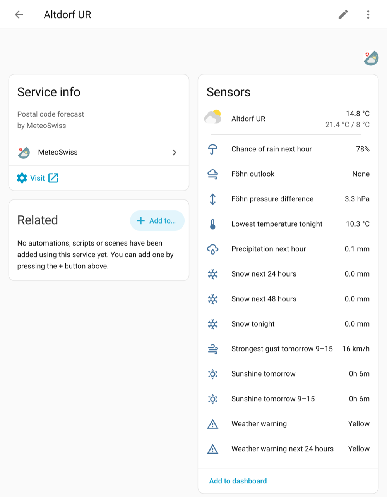
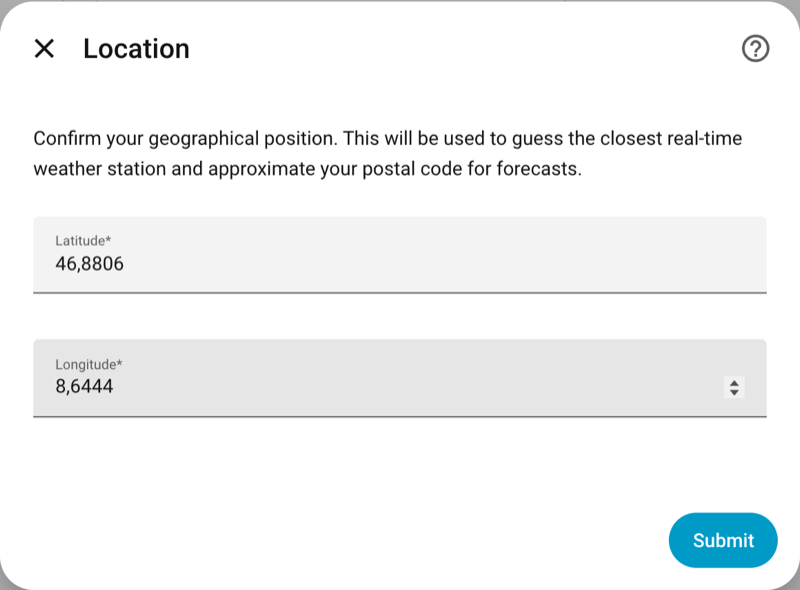
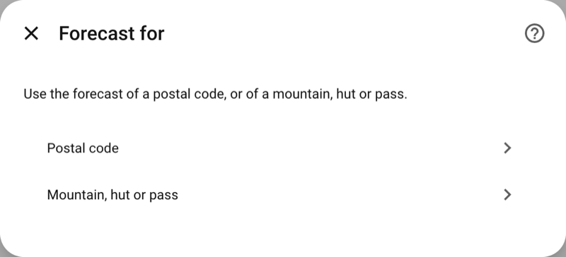
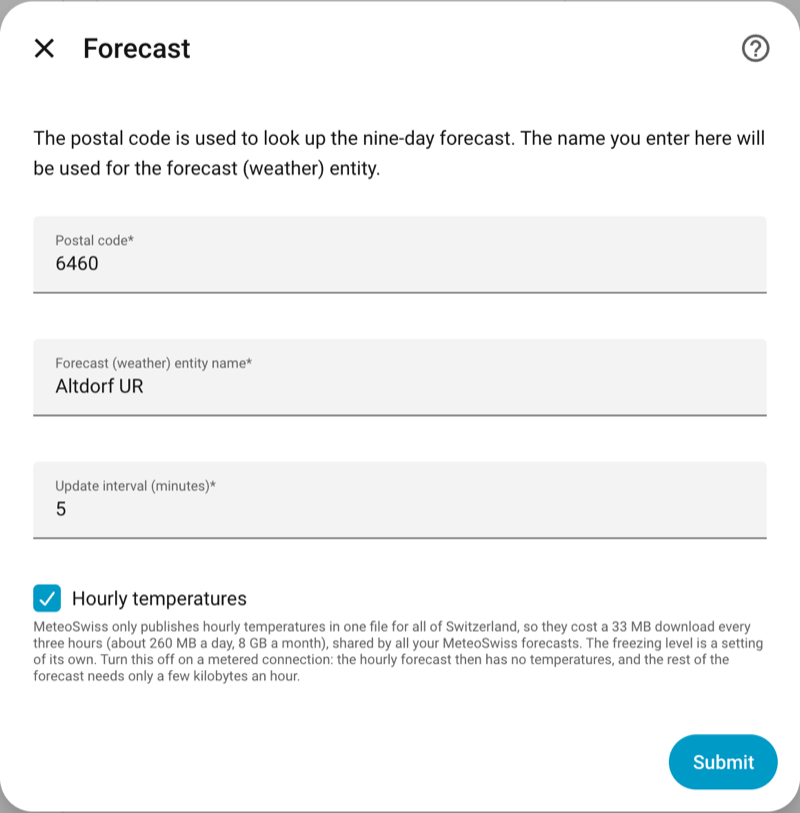
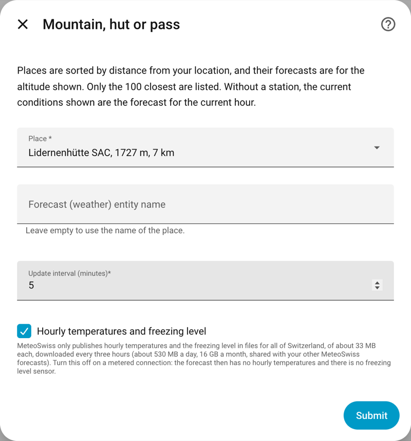
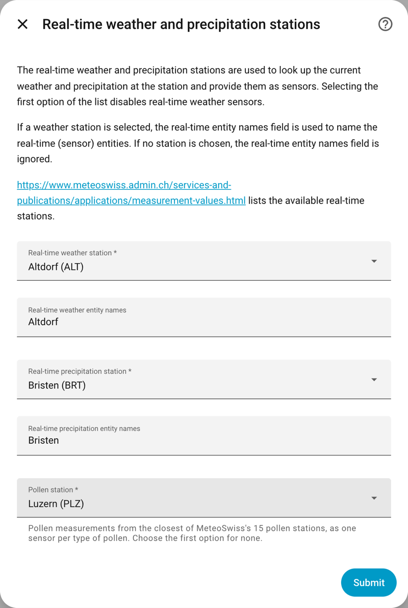
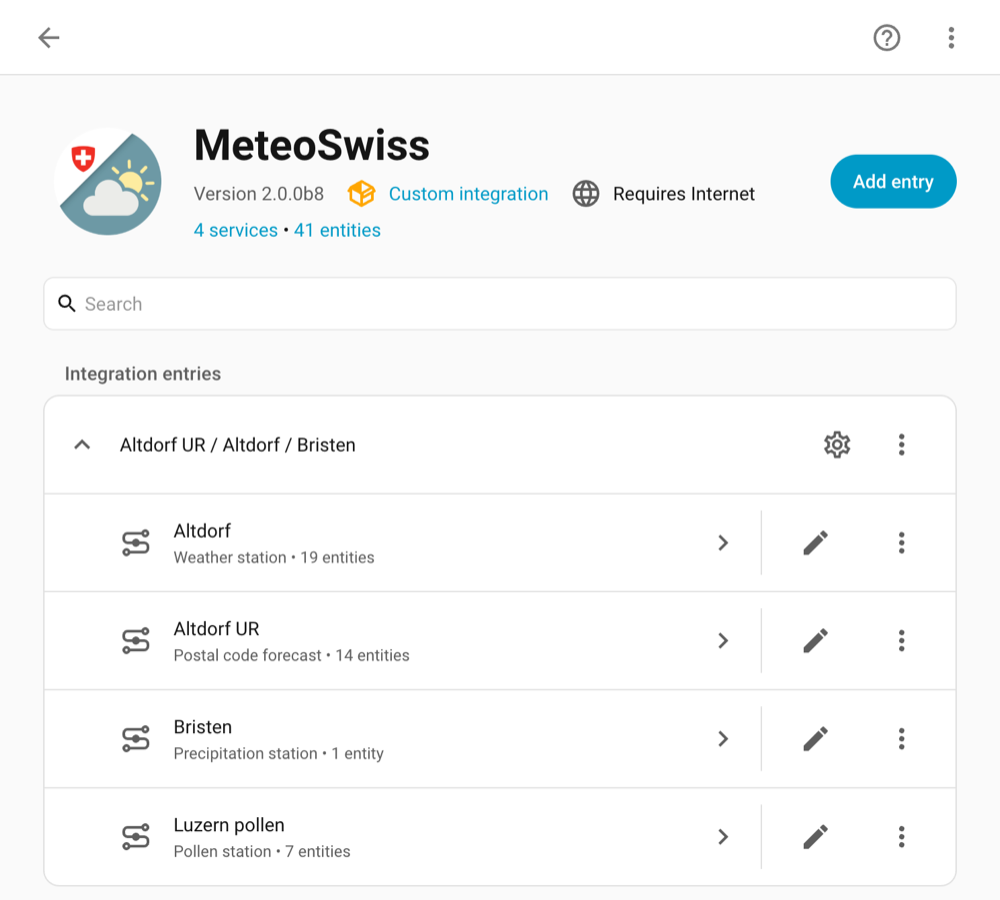
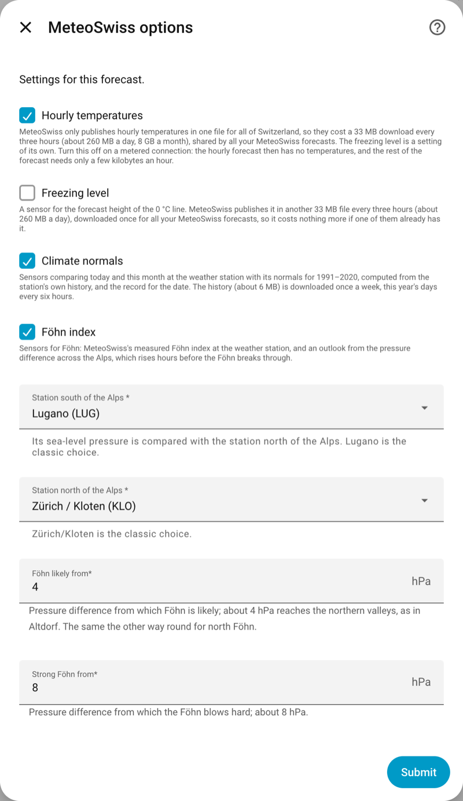
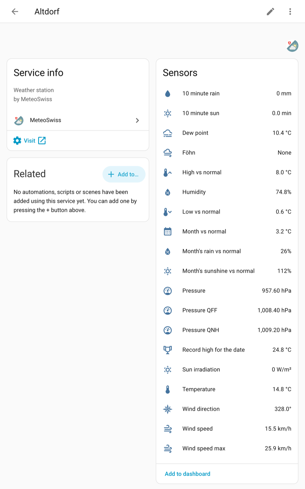

# MeteoSwiss for Home Assistant

[](https://github.com/hacs/integration)
[](https://github.com/janvt/homeassistant-meteoswiss/actions/workflows/tests.yaml)

Forecasts, measurements, warnings, pollen, Föhn and climate normals for
Switzerland in Home Assistant, from MeteoSwiss's official
[open data](https://opendatadocs.meteoswiss.ch/).  No API key and no account
are needed.

This started as a fork of [Rudd-O's integration](https://github.com/Rudd-O/homeassistant-meteoswiss)
(itself a fork of [websylv's original](https://github.com/websylv/homeassistant-meteoswiss)),
and is now maintained on its own: see [Credits](#credits).



## Features

* **Weather entity** with the daily (nine days) and hourly forecast of a postal
  code, or of one of MeteoSwiss's mountains, huts and passes, at its altitude.
  The forecast includes temperatures, precipitation and its probability,
  wind and gusts, cloud cover, sunshine and dew point.
* **Current conditions** from a SwissMetNet weather station every 10 minutes,
  and optionally rain from a separate precipitation station closer to you.
* **Forecast summaries** such as snow tonight, sunshine tomorrow or rain in the
  next hour, as sensors for dashboards and automations.
* **Weather warnings** of MeteoSwiss for the place, at its height, with a link to
  the warning on a map.
* **Pollen** measurements from the closest pollen station.
* **Föhn**: an outlook from the pressure difference across the Alps, and
  MeteoSwiss's Föhn index measured at the station.
* **Climate normals**: today and this month against the station's 1991–2020
  normals, and the record for the date.
* **Freezing level** forecast.
* Guided setup that suggests the postal code and stations closest to your Home
  Assistant location.  Stations, place and options can be changed later without
  losing entities or history.
* Repair notices when a station or a forecast stops publishing.
* Translations in English, German, French, Italian, Spanish and Norwegian.

## Installation

### HACS

1. In HACS, open the menu → *Custom repositories*, add
   `https://github.com/janvt/homeassistant-meteoswiss` with the type
   *Integration*.
2. Search for *MeteoSwiss* in HACS and download it.  Beta versions are listed
   when *Show beta versions* is turned on for the repository.
3. Restart Home Assistant.

### Manually

Copy `custom_components/meteoswiss` from the
[latest release](https://github.com/janvt/homeassistant-meteoswiss/releases) to
the `custom_components` folder of your Home Assistant configuration, and restart
Home Assistant.

### Coming from Rudd-O's or websylv's version

This integration has the same domain (`meteoswiss`) as Rudd-O's, so it replaces
it in place: remove Rudd-O's repository from HACS's custom repositories, add this
one and download it.  Existing entries keep working, with their entities and
history.  A few stations of the old data source no longer publish open data
(such as MRP and VSOXE); their sensors become unavailable and a repair notice
appears after an hour.  Choose *Reconfigure* to pick another station.

websylv's integration (*Meteo Swiss*, folder `meteo-swiss`) is a different
integration: remove it and its YAML configuration first, then set this one up.
YAML configuration of this integration is imported once and raises a repair
notice; remove it from `configuration.yaml` afterwards.

## Setup

Make sure your Home Assistant location is set (*Settings → System → General*),
as setup uses it to suggest a postal code and stations.  Then go to
*Settings → Devices & services → Add integration* and search for *MeteoSwiss*.

1. **Location.**  Confirm or change the coordinates used to find what is
   closest to you.

   

2. **Forecast for** a postal code, or a mountain, hut or pass.

   

3. **Forecast.**  For a postal code: the postal code (the closest is suggested),
   the name of the weather entity, the update interval of the station sensors,
   and whether to download hourly temperatures (see
   [Download volumes](#download-volumes)).

   

   For a mountain, hut or pass, pick it from the 100 closest, sorted by distance,
   with each one's altitude.  Its forecast is for that altitude.

   

4. **Stations.**  The weather station gives the current conditions, the
   precipitation station the 10-minute rain, and the pollen station the pollen
   sensors.  The closest are suggested; the first option of each list is
   *none*.  Summits rarely have a station nearby, so none is suggested for
   mountains: their weather entity then shows the forecast for the current hour
   as its current conditions.

   

The forecast and each station become a device of the entry:



Home Assistant names entities after their device, so a station sensor shows as
e.g. *Altdorf Temperature*.  Add the integration once more for each further place.

### Changing the setup

* **Reconfigure** (in the entry's menu) changes the postal code or place and the
  stations; entities and their history are kept.
* **Configure** (the cog) turns hourly temperatures, the freezing level, climate
  normals and Föhn on or off, and sets the Föhn stations and thresholds.

  

## Entities

### Weather station



Temperature, humidity, dew point, pressure (station, QFF and QNH), wind speed,
gusts and direction, 10-minute rain and sunshine and sun irradiation, from the
station's latest 10-minute measurement.  Values older than 90 minutes are not
shown; a value missing from the latest measurement is taken from the half
hour before.  A
precipitation station has only the 10-minute rain.

### Forecast summaries

Every forecast has sensors summarising it.  All times are local
(Europe/Zurich), and a window holds the hours that start in it.

| Sensor | Value |
|---|---|
| Snow tonight | mm of water from 18:00 to 08:00 (from the current hour on), counting the precipitation of hours at 0.5 °C or colder |
| Snow next 24 hours, Snow next 48 hours | The same, from the current hour on |
| Sunshine tomorrow 9–15, Sunshine tomorrow | Hours of sunshine |
| Strongest gust tomorrow 9–15 | km/h |
| Precipitation next hour, Chance of rain next hour | For the hour after the current one; the chance of rain is MeteoSwiss's for the three hours up to its end |
| Lowest temperature tonight | °C, 18:00 to 08:00 from the current hour on |
| Freezing level | Forecast height of the 0 °C line for the current hour, in m (when turned on) |

The snow and temperature sensors need *Hourly temperatures*.  A sensor is
unavailable when any hour of its window, or a value it needs, is missing,
rather than showing a partial result.  Being forecasts, these sensors keep no
long-term statistics.

To use the forecast itself in a template, call `weather.get_forecasts`:

```yaml
template:
  - trigger:
      - trigger: time_pattern
        minutes: /15
    actions:
      - action: weather.get_forecasts
        data:
          type: daily
        target:
          entity_id: weather.altdorf_ur
        response_variable: daily
    sensor:
      - name: Tomorrow max temperature
        unique_id: tomorrow_max_temperature
        unit_of_measurement: °C
        state: "{{ daily['weather.altdorf_ur'].forecast[1].temperature }}"
```

### Weather warnings

*Weather warning* (the most severe warning in force now) and *Weather warning
next 24 hours* are `none`, `yellow`, `orange` or `red`.  Their `warnings`
attribute lists each warning with its type (such as `wind`, `rain` or
`thunderstorm`), level, start, end, region, headline and text in Home
Assistant's language, and a `url` of MeteoAlarm's page of its region with the
warning on a map; `types` lists just the types, for templates such as a Föhn
warning (`wind` in Altdorf).

Each warning covers a region between two altitudes, so a place gets the
warnings of its region at its height: a ridge can be warned of wind while the
village below is not.  MeteoSwiss's warnings currently stop at 3000 m, so
summits above that get none.  The texts of warnings are not stored in the
history, only their types.

### Föhn

* *Föhn pressure difference* (forecast device): the sea-level pressure south
  of the Alps minus north of them, in hPa.  It rises hours before the Föhn
  breaks through: on 20 October 2026 it passed 4 hPa at 06:30 UTC, and the Föhn
  reached Altdorf at 12:30, at about 6 hPa.
* *Föhn outlook* (forecast device): from that difference, `strong_south`,
  `south` (likely), `none`, `north` or `strong_north` (north Föhn in Ticino).
* *Föhn* (weather station): MeteoSwiss's Föhn index measured at the station,
  `none`, `mixed` or `foehn`, for stations that have one.

The defaults are the classic pair Lugano and Zürich/Kloten, with Föhn likely
from 4 hPa and strong from 8 hPa; all can be changed under *Configure*.

### Climate normals

With a weather station, these sensors compare it with its normals for
1991–2020, computed from the station's own history (MeteoSwiss publishes its
official normals only as maps):

* *High vs normal* and *Low vs normal*: today's highest and lowest temperature
  so far against the normal for the date (the mean over 1991–2020 of a week
  either side of it), in °C above or below.
* *Month vs normal*: this month's mean temperature so far, in °C above or below.
* *Month's rain vs normal* and *Month's sunshine vs normal*: this month so far,
  in % of the normal for as many days.
* *Record high for the date*, with its year, and the record low as attributes.

Days are UTC days, as in MeteoSwiss's data, so early in the morning today's
high is still low.

### Pollen

One sensor per type of pollen (alder, ash, beech, birch, grasses, hazel and
oak) with the latest hourly concentration in pollen/m³ at the chosen station,
one of MeteoSwiss's 15.  They are measurements, not forecasts, and are
unavailable when the station has reported nothing for six hours.

## Download volumes

Most data takes a few kilobytes per update, and all entries share the same
downloads.  The exceptions are files MeteoSwiss only publishes for all of
Switzerland at once:

| Data | Download | Setting |
|---|---|---|
| Hourly temperatures | 33 MB every 3 hours, about 260 MB a day | *Hourly temperatures* (on by default) |
| Freezing level | 33 MB every 3 hours, about 260 MB a day | *Freezing level* (on by default for mountains with hourly temperatures) |
| Weather warnings | 800 kB at most every 30 minutes, about 37 MB a day | — |
| Climate normals | 6 MB a week per station, plus 50 kB every 6 hours | *Climate normals* |

On a metered connection, turn off *Hourly temperatures*: the hourly forecast
then has no temperatures, and the snow and lowest-temperature sensors are
unavailable.  Nothing is written to disk; downloads are kept in memory only as
long as needed.

## Data sources

All data is from MeteoSwiss (Source: MeteoSwiss), under its
[open data terms](https://opendatadocs.meteoswiss.ch/general/terms-of-use):

* [Local forecasts](https://opendatadocs.meteoswiss.ch/e-forecast-data/e4-local-forecast-data)
  of postal codes, stations and mountains, updated hourly.
* [Automatic weather stations](https://opendatadocs.meteoswiss.ch/a-data-groundbased/a1-automatic-weather-stations)
  and [precipitation stations](https://opendatadocs.meteoswiss.ch/a-data-groundbased/a2-automatic-precipitation-stations)
  (SwissMetNet), for the current conditions, Föhn and climate normals.
* [Pollen stations](https://opendatadocs.meteoswiss.ch/a-data-groundbased/a7-pollen-stations).
* Weather warnings, from MeteoSwiss's warnings as published by
  [MeteoAlarm](https://meteoalarm.org) (EUMETNET).

The daily chance of rain and gusts are the highest of the day.  Cloud cover
combines MeteoSwiss's low, medium and high cloud forecasts, assuming the layers
overlap at random; thin high cloud counts fully, so a sunny symbol can come
with high cloud cover.  The measured values are described in the
[parameter list](https://data.geo.admin.ch/ch.meteoschweiz.ogd-smn/ogd-smn_meta_parameters.csv).

### Privacy

The integration contacts only `data.geo.admin.ch` (forecasts, measurements and
the lists of places and stations) and `feeds.meteoalarm.org` (warnings).  Your
location never leaves Home Assistant: the closest postal code, stations and
warnings are found locally from those lists.

## Troubleshooting

Please report problems in the
[issues](https://github.com/janvt/homeassistant-meteoswiss/issues), with a debug
log.  To get one, turn on debug logging in the entry's menu, or add this to
`configuration.yaml` and restart:

```yaml
logger:
  logs:
    custom_components.meteoswiss: debug
```

## Development

```bash
pip install -r requirements_test.txt
pytest
ruff check
```

The tests run against in-memory copies of MeteoSwiss's files, so they need no
network.  CI runs them, ruff, hassfest and the HACS checks on every push.

## Credits

* [websylv](https://github.com/websylv/homeassistant-meteoswiss) wrote the
  original MeteoSwiss integration.
* [Rudd-O (Manuel Amador)](https://github.com/Rudd-O/homeassistant-meteoswiss)
  took it over, rewrote it with the setup flow, unique IDs, separate
  precipitation stations and repair notices, and maintained it for years with
  its contributors.
* This version replaces the MeteoSwiss app API those used with MeteoSwiss open
  data, and adds the hourly forecast, mountain forecasts, summaries, warnings,
  pollen, Föhn and climate normals.

Thanks to all of them, and to MeteoSwiss for publishing its data openly.
